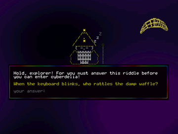
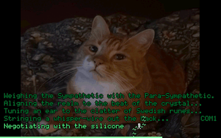
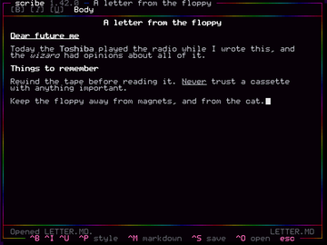

# FLOPOS

FLOPOS is a cyber-psychedelic (cyberdelic) neurofunkadelic dreamscape built from scratch and intended to run on the **Toshiba Satellite Pro 430CDT**.
It is not intended as a daily-driver OS but rather as an art project and an experiment bridging modern technology with old hardware.  
Really old hardware.

What do I mean when I say that it is built from scratch?  

It means:
* It does not build on code from any GNU/Linux project.
* Fact is, it does not use code from any other open-source project. Only two tables of numbers, the ones the MP3 and AAC standards define, were taken from open-source decoders, and they are credited.
* Oh yeah, and it's not some scene demo or whatever.  
  
  
**TLDR:** *"It's this weird operating system that works on an old 1990s Toshiba Satellite Pro 430CDT laptop."*  

... Or just have a look yourself.  
## Screenshots

  
  

FLOPOS's code is synthesized by Claude drawing upon my ideas, thoughts and curiosity. I'm fascinated by old hardware and media and I wanted to test what AI and ~30 year old hardware is capable of achieving when paired together. To see exactly where the limit goes and learn new things in the process.  
The ideas on how and what gets built come from whatever circulates in my mind at the time of implementation. Sometimes I instruct Claude to behave in a way, or add features, drawn from my experiences as a sysadmin and senior infrastructure engineer.  
Other times the ideas come from things based on culture genres of fiction (or non-fictional) media that I enjoy. Given my human hours of testing and creative processing, "vibe-coding" would not do it justice.

Like I said, it is an art project, and its rule is that everything runs on the laptop's own hardware: a 120MHz Pentium with 32MB of memory. Booted from a 1.44MB MF2HD floppy disk. 
So far, no dedicated helper servers, services or proxies. All processing happens on the laptop itself.

## So what's it made of? What can it do?
Everything is its own:
- A boot sector
- A protected-mode kernel
- Drivers for the screen, keyboard, sound, floppy, serial line and network card.
- A network stack with TLS 1.3 and post-quantum key exchange. Yes, you read that right.
- A Quirky shell: You start Right `here>`. (... Right now. Right here. Right now.) Oh, and there's a help menu! You can also type `[command] help` for examples.
  - If you type the wrong command, the wizard will guide you with his finite wisdom.
  - Trust his wisdom. He gets is from a cup of tea he drinks during bootup.

### Apps to help you out
- **Browzer**: Text-based web browser which supports online web radio across many streaming formats.
- **Scribe**: A word processor which can save files to the floppy. Document your experience.
- **Maelcum**: The coolest data cassette backup program you've ever used. (Probably the only one you've ever used.)
  - Inspired by a former spaceship pilot in William Gibsons Neuromancer; Maelcum transports your data between cyberdelia and the ferro-oxide realms of your backup tape.
- **Inventory**: Where your persistent data goes.

### Other cool stuff

- **Boots to 800×600** while listing relevant technical incantations. Saffran the cat greets you on the way in.
- **Generated background... music**: Claude whipped up a couple of C-rendered tunez when I requested something that sounds...  
    *"As if Autechre and Mefljus had met in the 90s and decided to do an act together with the Prodigy."*  
    You decide but it *does* grow on you.
- **Wireframe banana**: Tumbling in the upper right corner for good morale. 
- **A very tired wizard guarding the shell**: He asks a riddle, if you get it right, you get access.
- **A HUD**: Every cyberpunks right. `Ctrl-Shift-F10` anywhere shows the sound, the battery, how hard the 'puterz brain is *thunkin'*.
- **Seventeen keyboards**, from Swedish to Hebrew, Yiddish, Bulgarian and Ukrainian, with Hebrew written right to left and accent keys that work.
  - `Ctrl-Shift-F1` brings back the keyboard list if you get lost.
- **Gets online**: DHCP, DNS and `ping`. The `network` command gets you set up.
- **Music codecs**: MP3, AAC, Ogg Vorbis, FLAC and tracker songs.
- **Speaks TLS 1.3** with X25519MLKEM768, ML-KEM-768, ChaCha20-Poly1305 and
  AES-128-GCM, and makes every site prove who it is, up to Mozilla's trusted
  authorities. All of it written from the standards and checked against
  their published test answers on the machine itself.
- **Apps load from the floppy** beside the system, each behind a wall: it
  can touch only its own memory and must ask the system for everything
  else.
- **Remembers you**: a journal on the floppy that any computer can read,
  and every word it didn't know, which became the list of what to build
  next.

## Quick start

**Put it on a floppy.** Download the newest `flopos-X.Y.Z.img` from the
[Releases](../../releases) page. It is the whole 1.44MB disk. Then write it
to a 1.44MB (HD) diskette:

- **Linux**, with this repository: `tools/writefloppy.sh --image flopos-X.Y.Z.img`.
  It finds the floppy drive by itself, refuses to touch anything that is
  not exactly a 1.44MB disk, and checks every byte after writing. So far
  it has been used with a USB floppy drive; a PC's built-in drive should
  work the same way, but hasn't been tried.
- **Linux or a Mac**, without it: `sudo dd if=flopos-X.Y.Z.img of=/dev/YOURFLOPPY bs=512 && sync`.
  Find the right device first (`lsblk` on Linux, `diskutil list` on a
  Mac): `dd` writes over whatever you name, a hard disk too.
- **Windows:** a raw floppy image writer such as RawWrite for Windows,
  pointed at the image and the A: drive.

Then boot the laptop from the floppy, and answer the wizard.

**Build it yourself:**
Details in [Building](docs/development/building.md).

## On the floppy

The image is a genuine FAT12 floppy. Put it in DOS, Windows, Linux or a Mac
and you'll find the system, the journal and your documents as ordinary
files. It just also happens to boot.

## Documentation

**Using it**
- [Getting started](docs/user-guide/getting-started.md): putting it on a floppy, booting it, talking to it over a serial cable
- [Commands](docs/user-guide/commands.md): every word it knows, and the keys at the prompt and on the keyboards
- [The inventory](docs/user-guide/inventory.md): your files and folders, and how safe they are
- [scribe](docs/user-guide/scribe.md): the word processor
- [maelcum](docs/user-guide/maelcum.md): your files on an audio cassette
- [The network](docs/user-guide/network.md): the network menu, `ping`, and how private it is
- [browzer](docs/user-guide/browzer.md): the web browser, music and radio, forms, and pages' styles and scripts

**Working on it**
- [Building](docs/development/building.md): tools, the project's files, the floppy image, the emulator
- [Testing](docs/development/testing.md): the tests, the test tools, and the hardware for testing on the real laptop
- [Making apps](docs/development/making-apps.md): programs that live on the floppy beside the system
- [Releasing](docs/development/releasing.md): version numbers, the changelog, making a release
- [Training the wizard](docs/development/training-the-wizard.md): how his model is taught

**How it is made**
- [Architecture](docs/design/architecture.md): boot, memory, interrupts, the BIOS, the screen, the disk, the network stack
- [The hardware](docs/design/hardware.md): the laptop, and what FLOPOS does with each part
- [Techniques](docs/design/techniques.md): how radio plays without a pause on a 120 MHz Pentium, and the other inventions
- [The cassette format](docs/design/cassette-format.md): how files become sound on a tape, and are read back
- [Security](docs/design/security.md): the encryption, how a site proves who it is, and the security review
- [Lessons on the way](docs/design/lessons.md): what the laptop and the software taught, the hard way

**The project**
- [Roadmap](docs/project/roadmap.md): ideas waiting their turn, and open security items
- [References](docs/project/references.md): standards, datasheets, tools and inspiration
- [CHANGELOG.md](CHANGELOG.md): what changed in each release
- [SECURITY.md](SECURITY.md): reporting a security problem
- [CONTRIBUTING.md](CONTRIBUTING.md): taking part, and the rules FLOPOS is built by

## Provenance

Written from scratch against published standards and the publicly
documented PC interfaces. Toshiba's manuals and drivers were consulted for
facts about the machine; none of their code, firmware or text is included,
and they are not in this repository. See [References](docs/project/references.md).

All product names, brands and trademarks mentioned here and in the
documentation (Toshiba, Satellite Pro, Sound Blaster, Pentium and the rest)
are the property of their respective owners. FLOPOS is not affiliated with
or endorsed by any of them.

No copyrighted material is included without permission.

## Licence

Two tables of numbers in the audio decoders come from other projects; see
[licenses/THIRD-PARTY.txt](licenses/THIRD-PARTY.txt).

Everything, the code, the documentation and the pictures of Saffran and
Ozzy the cats, is under the [MIT License](LICENSE).

Created by Max, built with Claude.
