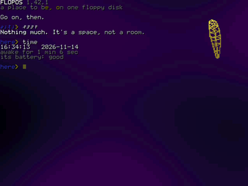
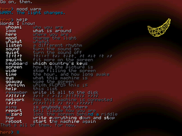
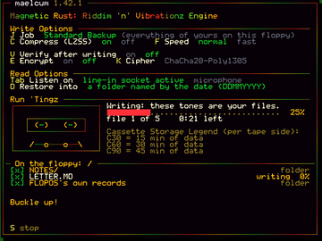

# FLOPOS

FLOPOS is a cyber-psychedelic (cyberdelic) neurodivergent dreamscape built from scratch and intended to run on the **Toshiba Satellite Pro 430CDT**.
It is not intended as a daily-driver OS but rather as an art project and an experiment bridging modern technology with old hardware. Really old hardware.

## Screenshots

 

*Left: the wizard at the gate, asking his riddle. Right: the terminal, once inside, in the dusk light. Click for full size.*

 

*Left: Saffran on the boot screen, while the machine tells him what it is doing. Right: `help`, in the warm light.*

 

*Left: scribe, the word processor, with a letter. Right: maelcum writing your files to a cassette.*

TLDR: 
***"It's this weird operating system that works on an old 1990s Toshiba Satellite Pro 430CDT laptop."***

What do I mean when I say that it is built from scratch?  It means:

* It does not build on code from any GNU/Linux project.
* Fact is, it does not use code from any other open-source project.
* Oh yeah, and it's not some scene demo or whatever.

FLOPOS's code is synthesized by Claude drawing upon my ideas, thoughts and curiosity. I'm fascinated by old hardware and media and I wanted to test what AI and 30 year old hardware is capable of achieving when paired together. To see exactly where the limit goes and learn new things in the process. The ideas on how it's built come from whatever cultural and experiential references that came to my mind at the time.

Given my human hours of testing and creativity, "vibe-coding" would not do it justice.
Sometimes I instruct Claude to behave in a way, or add features, drawn from my experiences as a sysadmin and senior infrastructure engineer. Other times the ideas come from things based on cultural genres of fiction (or non-fictional) media that I enjoy.

No copyrighted material is included without permission. See [docs](docs/project/references.md).

Everything is its own: a boot sector, a protected-mode kernel, drivers for
the screen, keyboard, sound, floppy, serial line and network card, a
network stack with TLS 1.3 and post-quantum key exchange, a web browser, a
word processor, a cassette backup program, and a shell where `here` is not
a folder. It fits on one floppy, with room to spare.

It is an art project, and its rule is that everything runs on the laptop's
own hardware: a 120MHz Pentium with 32MB of memory. No helper machines, no
proxies, no JavaScript.

## What it can do

- **Boots to 800×600** with smooth text over a slowly moving, generated
  background, music on the laptop's FM sound chip, and a wireframe banana
  tumbling in the corner. Saffran the cat greets you on the way in.
- **A wizard guards the shell.** He asks a riddle, accepts any answer, and
  afterwards answers every word FLOPOS doesn't know with a line from his
  own tiny language model: a quarter of a megabyte, trained for taste and
  whimsy, running on the laptop itself.
- **A HUD** for the cool cyberpunk: Ctrl-Shift-F10 anywhere shows the
  sound, the battery, how hard the processor works, and a turning brain.
- **Seventeen keyboards**, from Swedish to Hebrew, Yiddish, Bulgarian and
  Ukrainian, with Hebrew written right to left and accent keys that work.
  Ctrl-Shift-F1 brings back the keyboard list if you get lost.
- **Gets online**: DHCP, DNS and `ping`, and **browzer**, a small web
  browser with working forms and search, that plays internet radio and
  music files (MP3, AAC, Ogg Vorbis, FLAC and tracker songs) while you
  read.
- **Speaks TLS 1.3** with X25519MLKEM768, ML-KEM-768, ChaCha20-Poly1305 and
  AES-128-GCM, and makes every site prove who it is, up to Mozilla's trusted
  authorities. All of it written from the standards and checked against
  their published test answers on the machine itself.
- **scribe**, a word processor with bold, italic, underline, a title and
  four headings, saving Markdown documents any computer can open.
- **maelcum**, a backup program that keeps your files on an ordinary audio
  cassette as sound, prints a sleeve for the tape, and reads it all back,
  with a running commentary.
- **An inventory** of your own files and folders, as plain FAT12 files.
- **Apps load from the floppy** beside the system, each behind a wall: it
  can touch only its own memory and must ask the system for everything
  else.
- **Remembers you**: a journal on the floppy that any computer can read,
  and every word it didn't know, which became the list of what to build
  next.

## Quick start

**Put it on a floppy.** Download the newest `flopos-X.Y.Z.img` from the
[Releases](../../releases) page. It is the whole 1.44MB disk. Then write it
to a 1.44MB (HD) diskette:

- **Linux**, with this repository: `tools/writefloppy.sh --image flopos-X.Y.Z.img`.
  It finds the floppy drive by itself, refuses to touch anything that is
  not exactly a 1.44MB disk, and checks every byte after writing. So far
  it has been used with a USB floppy drive; a PC's built-in drive should
  work the same way, but hasn't been tried.
- **Linux or a Mac**, without it: `sudo dd if=flopos-X.Y.Z.img of=/dev/YOURFLOPPY bs=512 && sync`.
  Find the right device first (`lsblk` on Linux, `diskutil list` on a
  Mac): `dd` writes over whatever you name, a hard disk too.
- **Windows:** a raw floppy image writer such as RawWrite for Windows,
  pointed at the image and the A: drive.

Then boot the laptop from the floppy, and answer the wizard.

**Build it yourself:**

    make                      build dist/flopos.img
    make run                  boot it in QEMU
    tools/writefloppy.sh      put it on a real floppy

Needs `gcc` with 32-bit support, binutils, `mtools` and `python3`; QEMU to
run it without the laptop. Details in [Building](docs/development/building.md).

## On the floppy

The image is a genuine FAT12 floppy. Put it in DOS, Windows, Linux or a Mac
and you'll find the system, the journal and your documents as ordinary
files. It just also happens to boot.

`INVENTORY` is the folder with everything you have made. Everything beside
it is FLOPOS itself and its own records; leave those where they are.

## Who makes it

FLOPOS is an art project by [Max](https://machinemonarch.com/about/): a test of what an AI can build, of what
the Toshiba's hardware can still do, and of his own creativity. It is his
idea, and every decision in it is his: what FLOPOS is, what it is called,
how it looks, how it feels to use, what it says, and what is not good
enough yet.

Claude writes the code. Max does everything Claude can't: he runs every
release on the real laptop, hunts down what breaks, and reports back with
photos of the screen, the `report` command sent down a serial cable, and
his own notes, then reviews the result until it is right. That has taken
countless hours. The journal on the floppy lists every word typed that
FLOPOS did not know, and that list is the to-do list for new commands.

## What it is like

- **A place, not a directory.** Most command lines put you in a folder.
  FLOPOS puts you somewhere. The prompt is `here>`, and `here` is a space,
  not a path.
- **Words it knows** get an answer in a warm deadpan: polite, a little dry,
  never saying more than it needs to. Every one of those sentences lives in
  one file, `kernel/voice.c`. **Words it doesn't know** go to the wizard,
  who will, in his finite knowledge, make sure to answer you with something
  you'll probably struggle to understand.
- **Command names say what they do for you**, not how they work: `goaway`
  clears the screen, `remember` saves, `bye` switches the machine off.
- **Even the boot messages are true**, in a dialect of their own.
  "Aligning the realm to the beat of the crystal..." is the timer being
  started, which really does run off a crystal. "Flippely-Flopping" is the
  floppy being read.
- **The moving background** is generated, kept dark so the text always
  wins, and breathes with the music, a step sequencer playing on the FM
  chip.
- **Saffran**, Max's cat, is the first thing read off the floppy, and
  appears as fast as the drive delivers him. The machine then tells him,
  step by step, everything it is really doing to get ready.
- **Ozzy**, the other cat, sees the machine off when you say `bye` or
  `reboot`, while it tells him what it is doing to shut down.
- **The wizard** stands at the gate to the shell, which is called
  cyberdelia. He is very tired, asks a riddle assembled from word lists by
  the clock, and accepts every answer. Getting in plays a chip-tune
  jingle, then the screen ripples and glows while bells climb. The glow is
  kept gentle on purpose, for anyone sensitive to flashing light.
- **whaaat** pulls the whole screen through a hole in itself and turns it
  inside out. You'll find the rest.

## Documentation

**Using it**
- [Getting started](docs/user-guide/getting-started.md): putting it on a floppy, booting it, talking to it over a serial cable
- [Commands](docs/user-guide/commands.md): every word it knows, and the keys at the prompt and on the keyboards
- [The inventory](docs/user-guide/inventory.md): your files and folders, and how safe they are
- [scribe](docs/user-guide/scribe.md): the word processor
- [maelcum](docs/user-guide/maelcum.md): your files on an audio cassette
- [The network](docs/user-guide/network.md): the network menu, `ping`, the browzer web browser, and how private it is

**Working on it**
- [Building](docs/development/building.md): tools, the project's files, the floppy image, the emulator
- [Testing](docs/development/testing.md): the tests, the test tools, and the hardware for testing on the real laptop
- [Making apps](docs/development/making-apps.md): programs that live on the floppy beside the system
- [Releasing](docs/development/releasing.md): version numbers, the changelog, making a release
- [Training the wizard](docs/development/training-the-wizard.md): how his model is taught

**How it is made**
- [Architecture](docs/design/architecture.md): boot, memory, interrupts, the BIOS, the screen, the disk, the network stack
- [The hardware](docs/design/hardware.md): the laptop, and what FLOPOS does with each part
- [Techniques](docs/design/techniques.md): how radio plays without a pause on a 120 MHz Pentium, and the other inventions
- [The cassette format](docs/design/cassette-format.md): how files become sound on a tape, and are read back
- [Security](docs/design/security.md): the encryption, how a site proves who it is, and the security review
- [Lessons on the way](docs/design/lessons.md): what the laptop and the software taught, the hard way

**The project**
- [Roadmap](docs/project/roadmap.md): ideas waiting their turn, and open security items
- [References](docs/project/references.md): standards, datasheets, tools and inspiration
- [CHANGELOG.md](CHANGELOG.md): what changed in each release
- [SECURITY.md](SECURITY.md): reporting a security problem
- [CONTRIBUTING.md](CONTRIBUTING.md): taking part, and the rules FLOPOS is built by

## Provenance

Written from scratch against published standards and the publicly
documented PC interfaces. Toshiba's manuals and drivers were consulted for
facts about the machine; none of their code, firmware or text is included,
and they are not in this repository. See [References](docs/project/references.md).

All product names, brands and trademarks mentioned here and in the
documentation (Toshiba, Satellite Pro, Sound Blaster, Pentium and the rest)
are the property of their respective owners. FLOPOS is not affiliated with
or endorsed by any of them.

## Licence

Two tables of numbers in the audio decoders come from other projects; see
[licenses/THIRD-PARTY.txt](licenses/THIRD-PARTY.txt).

Everything, the code, the documentation and the pictures of Saffran and
Ozzy the cats, is under the [MIT License](LICENSE).

Created by Max, built with Claude.
