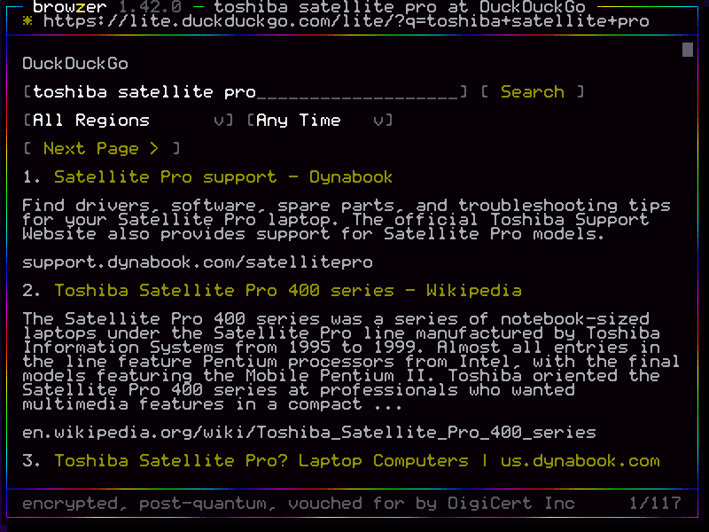
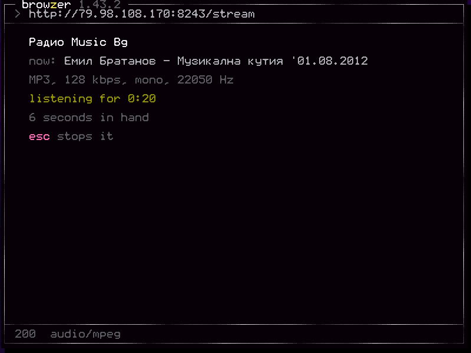

# browzer

browzer is FLOPOS's web browser, `BROWZER.APP` on the floppy. The system
gives it the secure connection;[^3] browzer does the rest.

    here> browzer
    here> browzer www.nojs.chat
    here> browzer fetch example.com

`browzer fetch` prints a page as text in the terminal instead.

## Keys

- **Up / Down**: Scroll a line.
- **Page Up / Page Down / Space**: Scroll a screen.
- **Tab / Shift-Tab**: Next / previous link.
- **Enter**: Follow the link.
- **Backspace or Left**: Back.
- **`g`**: Go somewhere. Ctrl-A picks the whole address.
- **`/`**: Find on the page, as in `less`: type, then Enter. **n** goes to the next, **N** to the one before, Esc clears.
- **`r`**: Load the page again.
- **`h`**: Home, which lists your bookmarks.
- **`b`**: Bookmark this page.
- **`m`**: Change your bookmarks: **p** puts one first, **d** twice deletes it.
- **`j`**: Allow this site's scripts, or stop them again.
- **`s`**: Stop the music.
- **Esc**: Stop a page loading; on its own, it asks whether to leave (`y` leaves).

Typing words instead of an address searches DuckDuckGo Lite. For smaller
text and more columns, leave browzer and type `squint`.

## Music and radio

Links to sound play through the Sound Blaster:

- **mp3**, **AAC** and AAC+, **Ogg Vorbis**, **FLAC** and **wav**.
- **Tracker songs**: mod, xm, s3m and it, such as those on modarchive.org.[^1]
- **Radio**: Shoutcast and Icecast stations, and their m3u and pls playlists.

A file under 2 MB plays in the background while you browse; **s** stops it.
Radio plays on a player screen with the station's name and song; **Esc**
stops it. The sound is decoded on the timer, so pages and the network do
not interrupt it.[^2]

A station's **Listen live** button is a link, with or without scripts. A
stream the page names only in its data is listed at the top, under "Streams and
recordings on this page", with the station's name when the page gives one.
AzuraCast stations and 72fm's country pages are asked for their streams
the way their own scripts would ask.

Not yet: Opus, and AAC inside .m4a files.

## Forms

Boxes, tick boxes, choices, lists and buttons work, so searches, logins
and chat pages can be used.

- **Enter on a box** starts typing; **Enter** again sends the form.
- **Enter on a tick box, choice or list** changes it.
- **Esc** stops typing without sending.

Not yet: file uploads.

## What else it does

- **Cookies** are kept in memory only, for the site that set them, and forgotten when browzer closes.
- **Images** become boxes with the picture's description.
- **Frames** show as links that open them.
- **A page that reloads itself** often, as chat pages do, is reloaded.
- **Bookmarks** are kept in `BOOKMARK.TXT`, which any computer can read.

## Styles

A page's CSS is read for what a text screen can show: hidden stays hidden,
bold, italic, underline, colour as a hint, centring and indents. Anything
pinned over the page (`position: fixed` or `sticky`) is never drawn, so
pop-ups, cookie walls and sticky bars are gone. Columns are drawn one
under the other.

Tables are laid out as tables: each column as wide as it needs, the long
ones wrapped, the rows side by side. A table too wide for the screen, or
one holding a whole page, is drawn one cell after another.

## Scripts

Scripts are off until you press **j** on a site. The bottom line says how
many a page has. Allowed sites are kept in `SITES.TXT`.

Scripts can change the page, react to clicks and forms, use timers,
`async` and `await`, and fetch from their own site. Libraries such as
jQuery work; reading one takes a few seconds on the laptop. Not yet:
generators and modules. Big modern sites (shops, maps, video) will not
work.

How they are kept safe:

- **The gate**: Scripts from other sites, and very big ones, are never fetched. The one exception: libraries from four public library hosts (jsDelivr, cdnjs, Google's and unpkg), over https, on sites you allowed.
- **The room**: Scripts run walled off in 4 MB of their own, with no network, files or cookies.
- **The door**: Every request goes through browzer, which checks it.
- **The clock**: Two seconds a script while the page loads, a little more for a big library (eight at most), half a second for a click.
- **Tripwires**: A script that sends anything to another site, or asks for something odd, is stopped.
- **No text made into code**: `eval` and its relatives never run.

[^1]: [modarchive.org](https://modarchive.org/)
[^2]: [techniques.md](../design/techniques.md)
[^3]: [The network: how private it is](network.md#how-private-it-is)
