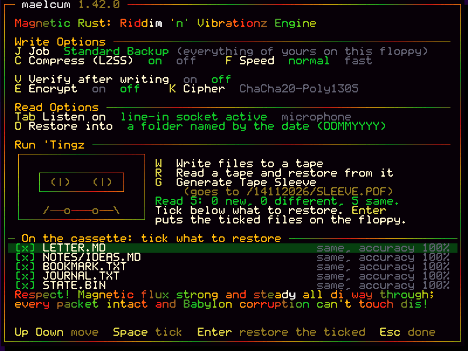

# maelcum: backup to an audio cassette

> **Warning: not for important data.** maelcum may work. It also may not.
> Consumer cassettes and recorders are unreliable: tapes stretch, wear,
> drop out and lose their treble, and a backup that read back fine today
> may not read next year. Keep the files that matter somewhere else too.
> FLOPOS comes with no guarantee of any kind (see the licence).

`maelcum` keeps a copy of your files on an ordinary audio cassette, as sound,
the way the home computers of the 1980s did. It is for a cassette recorder
with EAR and MIC sockets. It is named after the pilot in William Gibson's
*Neuromancer* (1984), who got people home.

On the laptop so far: reading a tape from a real recorder worked
(1.33.0), and so did writing with Verify at normal speed (1.35.0). Fast
speed with encryption read badly there (1.37.0); the reader was improved
for that in 1.38.0, and that has only been tried against a pretend tape.
Everything since 1.39.0 (restoring by ticks, the dated folder, the sleeve,
the fairer counting of lost pieces in 1.41) has been tried only in the
emulator.

## What it keeps

Everything in your inventory[^1], folders and all, and three
of the system's own records: browzer's bookmarks, the journal, and the
settings (the network's among them). Nothing else can go to a tape, and
what comes back can only go into the inventory or over one of those three.

At normal speed about 110 bytes go by each second, so 16 KB takes two and
a half minutes; packing usually halves that for text, and fast speed
halves it again. A file over 64 KB is left out, and `maelcum` says so.

## The screen

    here> maelcum

The top line names it, in colours that run through the letters, with a
glint that sweeps across it every few seconds.

At the top are the settings, each with its key, in two groups, and under
them a third, **Run 'Tingz**, with the cassette and the three things to do:
<kbd>W</kbd> write, <kbd>R</kbd> read and <kbd>G</kbd> generate a tape
sleeve. The value in force is green;
the one that is not is grey.

**Write Options**

- **<kbd>J</kbd>**: The job, from a list: **Standard Backup** (everything of yours on this floppy) or **Pick & Mix** (only what you tick, after <kbd>W</kbd>).
- **<kbd>C</kbd>**: Compress (LZSS): on or off. A file is sent packed when that is shorter.
- **<kbd>F</kbd>**: Speed: normal or fast. Fast takes half the tape and is easier to spoil: it wants a good recorder and tape. Reading needs no telling; it hears which.
- **<kbd>V</kbd>**: Verify after writing: on or off. On, the tape is read back straight after it is written.
- **<kbd>E</kbd>**: Encrypt: on or off (off to begin with). See below.
- **<kbd>K</kbd>**: The cipher, from a list of three.

**Read Options**

- **<kbd>Tab</kbd>**: Which socket listens: line-in or microphone.
- **<kbd>D</kbd>**: Restore into, from a list: **a folder named by the date**, DDMMYYYY (the first choice), where each file came from, the top of the inventory, any folder, or a folder you name, which is made at once at the top of the inventory.

The cassette's wheels turn while a tape is written or read, and beside it
is the progress. The bottom line names only the keys not already shown
above. Below is a list of files, and its title says whose:

- At first it is empty, so it is never unclear what is shown.
- <kbd>W</kbd> fills it with **the files on the floppy**, one folder at a
  time, as `inventory` shows them: <kbd>Up</kbd> and <kbd>Down</kbd> move,
  <kbd>Enter</kbd> goes into a folder, <kbd>Backspace</kbd> comes back out,
  and <kbd>Space</kbd> ticks a file, or a folder and everything in it.
  Ticking by hand makes the job Pick & Mix. <kbd>W</kbd> again writes the
  ticked files.
- <kbd>R</kbd> fills it with **the files on the cassette**, as they are
  heard, to tick and restore.

<kbd>Esc</kbd> empties it again.

Above the keys, one line keeps up a running commentary, cheerful when
all is well and less calm when pieces are being spoiled or the tape runs
off its speed. While recording it cannot hear the tape, so there it goes
only by how far along it is; the real judging happens when the tape is
played back. When a tape has been read, it sums up with a verdict,
positive or negative, in the title's turning colours. The plain facts
stay on the screen beside the cassette and in the list.

The screen keeps to red, gold and green on black, frame included, with
the keys in yellow (everywhere else in FLOPOS they are pink) and what is
switched on in a dark neon green.

## Writing

1. Press <kbd>W</kbd>: the floppy's files are shown, ticked by the job.
   Change the ticks if you like, and press <kbd>W</kbd> again. It says
   how much tape the ticked files need, with a legend of what one side of
   a C30, C60 and C90 holds.
2. Plug a cable from the laptop's headphone socket (on the front) into
   the recorder's MIC socket.
3. Set the recorder recording, then press <kbd>Enter</kbd>. The first
   eight seconds are a plain tone, to get past the clear leader at the
   start of a cassette.
4. The red bar and the percentage show how far it has come. When all of
   it is on the tape there is a little tune. Stop the recorder. With
   Verify on there is no tune yet: stop the recorder, rewind and press
   PLAY on it, and the tune comes when the check has passed.

<kbd>S</kbd> stops early. The laptop cannot hear the tape while it is being
recorded, so the only way to be sure of a save is to read it back: that is
what Verify does.

## Reading

1. Plug a cable from the recorder's EAR socket into the laptop's line-in
   socket (left side, marked with a note and an arrow).
2. Press <kbd>R</kbd>, rewind the tape and set the recorder playing. The
   green bar shows how loud the tape is, and under it whether what is
   heard is a tape's tones.
3. The list fills with the files on the tape as they are heard, each with
   how much of it has been read and its accuracy: the share of its pieces
   that passed their check.

Reading ends by itself when every file has come whole, or after ten
seconds of silence; <kbd>S</kbd> ends it sooner. If everything came
whole (every file the save has, not only the ones heard), the tune plays;
if it did not, a shorter, sadder one does, and the line says how many
came whole. The screen shows the result before the tune starts.
Stopping by hand is not held against the tape: it gets a poor verdict
only if pieces were actually spoiled.

The whole save is kept in memory; nothing has touched the floppy. The
list shows **what the tape holds**, each file marked new (not on this
floppy), different (from the floppy's copy) or same.

By default a read is restored into **a folder of its own**, named by the
day the reading ended, DDMMYYYY: `14112026` is the 14th of November 2026
(with no clock, `TAPE01`, `TAPE02`...). A second read on the same day
goes into the same folder. Everything that came whole starts ticked, so the
folder is a whole copy of the tape, with the files' own folders inside
it. Nothing already on the floppy is touched; the system's three records
land there as ordinary files.

With <kbd>D</kbd> set to **where each file came from**, only the new ones
start ticked. A different one is left unticked, since restoring it
replaces the floppy's copy, which may be the newer; tick it if the tape's
is the one you want. The same ones are grey.

<kbd>Space</kbd> ticks, <kbd>Enter</kbd> puts the ticked files on the
floppy, and the line says where they went. <kbd>Esc</kbd> leaves without
restoring. A tape from another floppy restores just as well.

If pieces are missing (a dropout, a crease in the tape), rewind, press
<kbd>R</kbd> and play it again.

The journal grows as FLOPOS is used, so after a while it will always be
"different" from the tape's. That is as it should be.

## The tape sleeve

<kbd>G</kbd> (Generate Tape Sleeve) makes the paper that goes in the
cassette's box, for the tape last written or read. It saves one file,
`SLEEVE.PDF`, and the screen shows where before you press it: for a tape
read, in the folder it was restored into; for a tape written, at the top
of the inventory.

It is a PDF of one A4 page with both cards on it, touching, one above
the other:

- **Top**: The outside: the front, the spine and the flap. The date and time the write or read finished (DD-MM-YYYY HH:MM), what was said of the tape, in quotes, and how much is on it.
- **Bottom, upside down**: The inside: the files and their sizes.

Take the floppy to a computer with a printer and print it at 100%
("actual size"), on one side. A PDF page carries its own size, so the
card comes out exactly a standard sleeve's size, 101.6 mm square: the
front 65 mm, the spine 12.7 mm, the flap 23.9 mm. Cut around both cards
as one piece, fold the lower one back along the dashed line between
them, and then fold along the other dashed lines. The inside is printed
upside down so that, folded back, it reads the right way up, with the
file list behind the front.

(Side by side would not fit: two cards are 203 mm and A4 is 210 mm wide,
nearer the edge than most printers can print.)

A tape written without Verify has had nothing said of it, so its sleeve
carries no quote. For an encrypted save the inside says how many files
there are and no more: the names are sealed on the tape and would be
plain on the paper.

Why PDF: it is an ISO standard (ISO 32000) and every computer and phone
of the last twenty-five years opens it; this one is the plainest kind
(version 1.3, two pictures packed by run length, and two lines of
Helvetica, which every reader has built in), about 23 KB. A bare picture
has no paper size of its own, so the print program stretches it to the
page. At 23 KB the sleeve is small enough for a tape, so the next backup
takes it along like any other file.

## Encryption

With Encrypt on, writing asks for a passphrase, twice. Each file's name
and contents are then sealed before they become sound; only how many
files there are, and roughly how long each is, can be told from the tape.

Reading a sealed tape needs Encrypt on and the same passphrase. A wrong
passphrase, or a tape whose data was changed, is refused outright:
nothing is restored. With Encrypt off, a sealed tape is recognised and
`maelcum` says so.

- **ChaCha20-Poly1305** (256-bit): Quick on this laptop. The one to use.
- **AES-256-GCM** (256-bit): As strong; several times slower here, since the Pentium has no AES instructions.
- **AES-128-GCM** (128-bit): Sound today, but not against a future quantum computer.

A 256-bit cipher is what "quantum-safe" means for a backup locked with a
passphrase. The post-quantum key exchange FLOPOS uses online (ML-KEM) is
for two parties agreeing on a key, which a tape does not need.

**The passphrase is the weak point, not the cipher.** It is turned into
the key by PBKDF2-HMAC-SHA256 with a fresh random salt and 10,000 rounds,
about two seconds on this laptop. A fast modern computer can try many
thousands of guesses a second against that, so a short or common
passphrase can be found. Four or more random words cannot, in practice.

**The passphrase is kept nowhere.** It is wiped from memory when the
write or read ends. Forget it and the tape cannot be opened by anyone.

How it is put together: a save has one key. Each header is sealed with
its open part (cipher, place in the save, save number, rounds, salt) as
associated data; each file's bytes are sealed whole after packing, and
the 16-byte tag travels with them. Nonces name what is sealed (header or
file) and which file; they never repeat within a save, and every save
has a new salt and so a new key.

## From the prompt

    here> maelcum save
    here> maelcum load
    here> maelcum save letter.md

`maelcum save` opens the screen ready to write, `maelcum load` opens it
listening. A name after either keeps to that file.

## Volume

Nobody has measured the right levels on a real recorder yet, so these are
starting points:

- **Writing:** The laptop's volume wheel at about half. A MIC socket wants
  a weak signal, and a headphone socket turned right up can distort the
  tones. A data recorder with automatic level sets its own recording
  level.
- **Reading:** Start the recorder's volume at about a third, press
  <kbd>R</kbd> and play, then turn it up until the green bar sits half to
  three-quarters full and the line under it says "a tape's tones". Too
  loud is worse than too quiet. If the recorder has a tone (treble) knob,
  turn it towards bright: weak treble is what spoils fast speed.

To find your settings, tick one small file, switch Verify on and write it
at normal speed. If the check passes and the commentary stays cheerful,
keep the knobs there, then try fast speed the same way.

## Several backups on one cassette

A cassette can hold one backup after another. maelcum reads the first one
it hears, so to read a later one, start the tape just before it. If the
tape runs on into an older backup, its files are ignored.

## Tape types

Type I, II and IV cassettes all work and need no setting: the tones are
far below the treble where the types differ. A simple recorder may not
fully erase a Type IV (metal) tape.

## On the tape

How the files become sound, and are read back: [the cassette
format](../design/cassette-format.md).

[^1]: [inventory](inventory.md)
