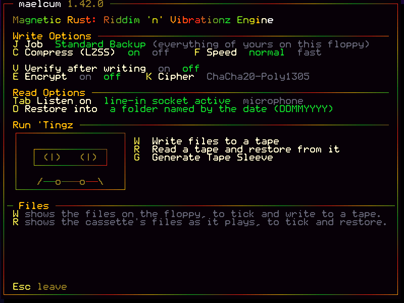
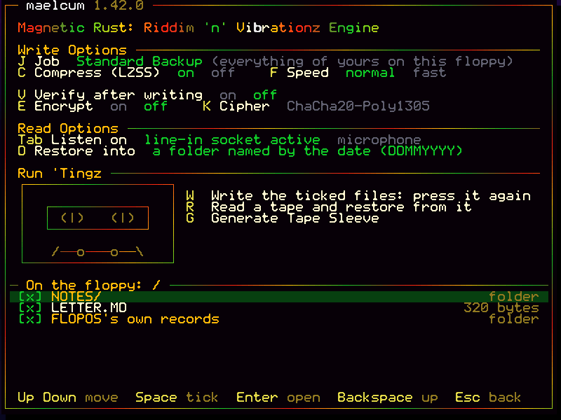

# maelcum: backup to an audio cassette

> **Warning: not for important data.** maelcum may work. It also may not.
> Tapes stretch, wear, drop out and lose their treble, and a backup that
> reads today may not next year. Keep the files that matter somewhere
> else too. FLOPOS comes with no guarantee of any kind (see the licence).

`maelcum` keeps a copy of your files on an ordinary audio cassette, as
sound, the way 1980s home computers did. It needs a recorder with EAR and
MIC sockets. It is named after the pilot in William Gibson's
*Neuromancer*, who got people home.

## What it keeps

Your whole inventory[^1], and three system records: the bookmarks, the
journal and the settings. Normal speed moves about 110 bytes a second (16
KB in two and a half minutes); packing roughly halves that for text, and
fast speed halves it again. Files over 64 KB are left out, and it says so.

## Settings

- **J:** The job: **Standard Backup** (everything) or **Pick & Mix** (what you tick).
- **C:** Compress (LZSS), on or off.
- **F:** Speed: normal, or fast (half the tape, wants a good recorder). Reading hears which.
- **V:** Verify: read the tape back straight after writing.
- **E:** Encrypt, on or off. **K** picks the cipher.
- **Tab:** Listen on line-in or the microphone.
- **D:** Restore into: a folder named by the date (DDMMYYYY, the default), where each file came from, the top of the inventory, any folder, or a new one you name.

**W** writes, **R** reads, **G** makes a tape sleeve, **S** stops, **Esc**
empties the list.

## Writing

1. Press **W**. The floppy's files are listed, ticked by the job: Up and Down move, Enter goes into a folder, Backspace back out, Space ticks. Press **W** again; it says how much tape that needs.
2. Cable from the laptop's headphone socket (front) to the recorder's MIC.
3. Start recording, then press **Enter**. Eight seconds of tone pass the leader.
4. A tune plays when it is done. With Verify on, rewind, press PLAY, and the tune comes when the check passes.

The laptop can't hear the tape while recording, so Verify is the only way
to be sure.

## Reading

1. Cable from the recorder's EAR to the laptop's line-in (left side).
2. Press **R**, rewind, and play. The green bar shows the level, and under it whether it hears a tape.
3. Files are listed as they are heard, with how much has come and how much passed its check.

It ends by itself when everything is whole or after ten seconds of
silence. A happy tune means everything came whole; a sadder one says how
many did. Nothing has touched the floppy yet. Files are marked new,
different or same.

**Enter** puts the ticked files on the floppy; Esc leaves without. By
default everything whole goes into a folder named for the day (`14112026`;
`TAPE01` with no clock). With **D** set to where each file came from,
only new files start ticked, since a different one would replace your
copy. If pieces are missing, rewind and read again: only the gaps are
filled.

## The tape sleeve

**G** saves `SLEEVE.PDF` for the last tape written or read: one A4 page
with the outside (front, spine and flap, with date and verdict) and,
upside down below it, the inside (the files). Print at 100% ("actual
size"), cut round both as one piece, fold the lower one back along the
dashed line, then fold along the others. An encrypted save's sleeve lists
only how many files.

## Encryption

With Encrypt on, writing asks for a passphrase twice, and each file's
name and contents are sealed. Reading needs Encrypt on and the same
passphrase; a wrong one, or changed data, restores nothing.

- **ChaCha20-Poly1305:** Quick on this laptop. The one to use.
- **AES-256-GCM:** As strong, several times slower here.
- **AES-128-GCM:** Sound today, not against a future quantum computer.

**The passphrase is the weak point.** It becomes the key by PBKDF2 with
10,000 rounds, which a fast computer can guess against: use four or more
random words. It is kept nowhere; forget it and the tape is lost.

## From the prompt

    here> maelcum save
    here> maelcum load
    here> maelcum save letter.md

## Levels

Starting points, not yet measured on a real recorder:

- **Writing:** the laptop's volume at about half.
- **Reading:** the recorder's volume at a third, then up until the green bar is half to three-quarters full and it says "a tape's tones". Too loud is worse than too quiet. Turn any tone knob towards bright.

Find your settings with one small file, Verify on, at normal speed; then
try fast. One cassette can hold several backups: start the tape just
before the one you want. Type I, II and IV tapes all work.

How the files become sound: the cassette format[^2].

[^1]: [inventory](inventory.md)
[^2]: [The cassette format](../design/cassette-format.md)
