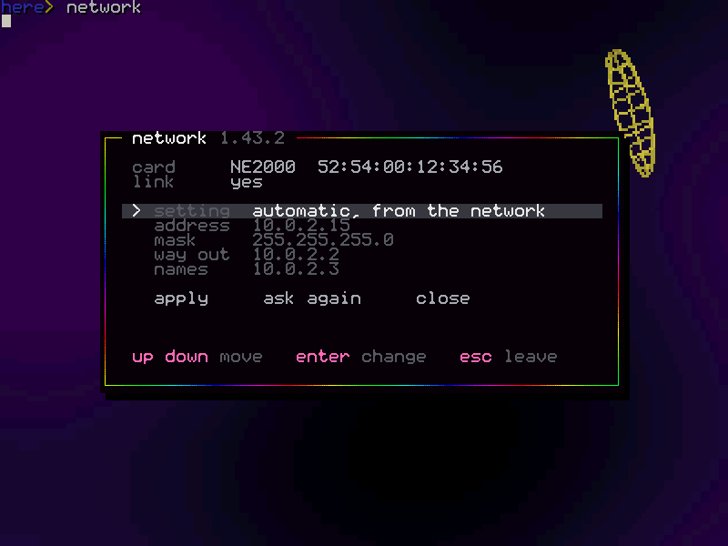

# The network

FLOPOS gets on a wired network, finds names, pings, and fetches secure
pages, all on the laptop's own processor. The browser has its own
page.[^1]

## The card

A **3Com 3C589** Ethernet PC Card in either slot, with its dongle and a
network cable. FLOPOS switches it on the first time anything needs the
network. *"The card is up, but nothing is plugged into it"* with a cable
in: push the dongle fully in and check the switch port's light.

## `network`

Shows the card, the link, and the setting: automatic (DHCP) or by hand,
with address, mask, way out (gateway) and name server. Tab and Shift-Tab
go round every setting and button, Enter changes or edits, Esc leaves.
Settings made by hand are kept on the floppy.

`ip` shows the same; `ip 192.168.1.50 255.255.255.0 192.168.1.1` sets it.
`ping example.com` times four answers.

## How private it is

- **TLS 1.3,** or **TLS 1.2** for sites with nothing newer, with the ciphers Chrome still offers and nothing older. A TLS 1.3 site answering in 1.2 is refused (someone forced the older version).
- **Post-quantum key exchange:** X25519MLKEM768, so traffic recorded today stays private against a future quantum computer. Sites without it fall back to X25519.
- **The site must prove who it is,** up to one of 119 authorities from Mozilla's list (`ROOTS.DAT`), and sign the handshake with its own key. browzer's status line says who vouched.
- **`crypto`** checks every piece against published answers on the laptop.

Details: Security[^2].

### When a site can't prove who it is

FLOPOS refuses the page and says why: the certificate names another site,
it is out of date, nobody trusted vouches for it, a signature fails, the
site can't sign with its key, or the laptop's clock is far off. In
browzer, **a** goes there anyway, marked "NOT checked, could be anybody":
type nothing private there.

Not done: revocation checks, and fetching an authority's certificate a
site forgot to send.

**The clock** sets itself whenever the network comes up (Swedish time),
from signed time first (NTS): the time server proves who it is as a
secure site does, and signs every answer, so nobody on the network can
wind the clock back. `clock` opens a menu for how far to trust the
network beyond that: signed only; signed, then the time server your own
network names (the default); or signed, then any. It also lists the
signed servers, which you can change, and says where the time last came
from. Without an answer it keeps its own time, and it never goes back
before the time `bye` wrote.

**Updating the authorities:** `tools/build/mkroots.py` rebuilds
`data/roots.dat` from a Linux PC's `/etc/ssl/certs/ca-certificates.crt`.

Esc cancels a stuck page; a silent server is given up on after 15
seconds.

[^1]: [browzer](browzer.md)
[^2]: [Security](../design/security.md)
