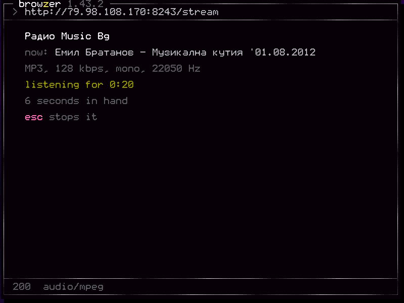

# The network

FLOPOS can get on a wired network, find names, ping, read web pages and
fetch secure (https) pages, all on the laptop's own processor.

## The card

The laptop has no network port of its own. FLOPOS drives a **3Com 3C589**
Ethernet PC Card (EtherLink III) in either PC Card slot, with the usual
dongle and a network cable.

It switches the card on the first time anything needs the network. If the
card is found but no cable signal is seen, it says *"The card is up, but
nothing is plugged into it."* If that happens with a cable in, check that
the dongle is pushed fully into the card and that the light on the switch
port is on.

The other card in the laptop, a LASAT Credit 560 modem, is recognised by
`card` but not driven yet.

## `network`: the menu

    here> network

A window showing:

- the **card** and its **link**: whether a cable is connected
- the **setting**: *automatic, from the network* (DHCP) or *by hand*
- **address**, **mask**, **way out** (the gateway, the router to the rest
  of the internet) and **names** (the name server that turns
  `example.com` into an address)
- **apply**, **ask again** and **close**

Up and Down move, Enter changes or edits, Esc leaves. Over the serial line
the arrow keys work too, and Tab moves down. Settings made by hand are
saved to the floppy and still there after switching off.

Without the menu, `ip` shows the same information and
`ip 192.168.1.50 255.255.255.0 192.168.1.1` sets it by hand.

## `ping`

    here> ping example.com

Finds the machine's address, asks it four times whether it is there, and
times each answer. FLOPOS also answers pings itself.

## `browzer fetch`

    here> browzer fetch example.com
    here> browzer fetch https://www.rfc-editor.org/

Reads a web page and prints it as text in the terminal: headings stand out,
links are marked, words are wrapped to the screen, Swedish letters come out
right, and redirects are followed. It is browzer reading the page out
rather than showing it, so the two always agree.

## browzer

    here> browzer
    here> browzer www.nojs.chat

A small web browser that takes the whole screen. The address is along the
top, the page in the middle and a status line along the bottom. It is an
app, `BROWZER.APP` on the floppy: the system provides the connection
(including the secure part and the certificate check), and browzer does
the rest.

| Key | What it does |
|---|---|
| Up / Down | Scroll a line |
| Page Up / Page Down / Space | Scroll a screen |
| Tab / Shift-Tab | Next / previous link |
| Enter | Follow the selected link |
| Backspace or Left | Back |
| `g` | Go somewhere: the current address, ready to change |
| `r` | Load the page again |
| `h` | Home |
| `b` | Bookmark this page |
| `s` | Stop the music |
| `m` | Your bookmarks |
| Esc | Cancel a page that is taking too long; on its own, it asks whether to leave (`y` leaves) |

After `g`, Left and Right move along the address (the letter under the
caret is underlined), Home and End jump to its ends, Backspace and Delete
remove a letter, and Ctrl-A picks all of it, so the next letter typed
replaces it. Enter goes there; Esc leaves it as it was.

Esc never leaves browzer by itself: it asks first, and only `y` answers
yes. The laptop's Esc key can bounce, and a second Esc used to close
browzer when the first was meant to stop a page loading.

### Music and radio

Links to sound play it, through the Sound Blaster:

- **.mp3**: MPEG-1, -2 and -2.5 layer III, any bitrate
- **.aac**: AAC LC and HE-AAC (AAC+), as ADTS: what most AAC stations send
- **.ogg**: Ogg Vorbis, any quality; and FLAC inside Ogg
- **.flac**: FLAC, 8 to 24 bits, up to 8 channels
- **.wav**: plain PCM, 8 to 32 bits, any rate, any number of channels
- **.mod**, **.xm**, **.s3m**, **.it**: tracker songs (ProTracker, FastTracker 2, Scream Tracker 3, Impulse Tracker), such as the ones on modarchive.org[^1]
- **radio**: mp3, AAC, Ogg and FLAC stations (Shoutcast, Icecast), and their **.m3u** and **.pls** playlists

**A file of 2 MB or less** is downloaded first, then plays in the background
while you go on browsing. The top edge shows what is playing and for how
long, and **s** stops it.

**Radio, and anything bigger,** plays as it arrives, on a player screen with
the station's name, what the station says is on now, and how long you have
been listening. **Esc** stops it.

It starts once about three seconds have arrived, and the player screen
shows how many seconds are in hand. The decoding is done by the system's
timer, whatever browzer is doing, so the music doesn't pause for pages,
drawing or the network (see techniques.md[^2]). If the
network ever falls behind and the sound runs out, it gathers a bigger
cushion before going on, rather than stuttering through each scrap: 6
seconds, then 12, then 24. A station that sends slower than it plays
still runs out in the end, only less often. A
station that hangs up is called back, up to five times in a row.

Everything plays in mono, at about 22 kHz, which is what the laptop's Sound
Blaster plays. To keep up on a 120 MHz Pentium, mp3, AAC and Ogg Vorbis at
44.1 or 48 kHz are decoded at half rate, which skips everything above 11 kHz
that the card couldn't play anyway. HE-AAC is AAC at half the rate plus a
little extra data that rebuilds the treble; browzer plays the half-rate
part as it is, which at 22 kHz loses next to nothing. FLAC is decoded in full, then
neighbouring samples are averaged so the highs don't fold back down as
noise. The FM music steps aside while anything plays, and leaving browzer
stops it all.

Not yet: Opus, and AAC inside .m4a or .mp4 files (stations send AAC
plainly, which works).

A downloaded song or recording is kept in browzer's own memory, up to
2 MB, never on the floppy. It is gone when something else plays or browzer
is left.

**Players made of JavaScript.** Many stations' pages play through a script
that browzer doesn't run, and keep the stream's address inside it, or in
the page's data, rather than in a link. browzer reads every page as it
arrives for addresses of things to listen to (an mp3, AAC or Ogg file, a
playlist, a song, or anything a page calls its "stream"), and lists them at
the end of the page, under "Sound this page names", as links. Nothing in
them is run. An address written out as text is a link to itself as well.

AzuraCast stations (Chiptune Radio is one) draw their page entirely from
the station's own description. On such a page browzer asks the station for
that description, `/api/nowplaying/` and the station's name, and lists the
streams it names in the same way.

72fm.com's country pages (`/radio/il` for Israel, `/radio/se` for Sweden)
name their stations as plain text, and their script fetches the list from
the open Radio Browser directory, which the page names. browzer asks that
directory the same question and lists the country's 40 most voted stations
as links, each with its format and bit rate. Hebrew and Cyrillic names
are shown as they are, Hebrew right to left. A name in a script the font
can't draw (Arabic, say) is shown by its Latin part alone, or as "(a name
in Arabic)".

### Pages that remember you, reload, or come in frames

- **Cookies** are kept so a site can remember you between pages: a login,
  a chat's name. They are kept as close to harmless as they can be: in
  memory only, forgotten when browzer closes, never written to the floppy.
  They go back only to the site that set them, only along the path it
  named, and if marked Secure only over https. browzer never loads what a
  page merely embeds, so no other site can set one through it.
- **A page that reloads itself** (`<meta http-equiv="refresh">`) is
  reloaded if it asks every 30 seconds or less, as chat pages without
  JavaScript do, and it comes back where it was scrolled to. Slower ones,
  such as a news page that refreshes every few minutes, are left alone.
  Nothing reloads while you are typing or choosing.
- **Frames** aren't drawn inside the page. Each shows as a link,
  `[a frame: messages]`, that opens it.
- **A slow answer**, such as an AI's, gets a minute to begin, then up to 15
  seconds of silence before browzer gives up.
- **Big pages**: up to 2,048 links each. SomaFM's front page has 1,123.
- **Playlists** list a station's servers in order. If the first doesn't
  answer, the next is tried.

### Bookmarks

**b** keeps the page you are on. The home page lists them all, and nothing
else. **m** shows them as a page to change them: Tab picks one and Enter
goes there. On that page, **p** puts the picked one first on the home page,
or back among the rest, and **d** twice deletes it.

They are kept in `BOOKMARK.TXT` on the floppy, one a line (the address,
then the title, with `*` in front of those put first), so any computer can
read them. Writing a new version of FLOPOS to the floppy keeps
them.

### Forms

Text boxes, tick boxes, choices, lists and buttons on a page work, so
search boxes, logins, settings pages and chat pages like nojs.chat can be
used.

- A box is drawn as `[__________]` and a button as `[ Send ]`. Tab
  reaches them the same way it reaches links.
- **Enter on a box** starts typing into it. The status line says so, and a
  block shows where the next letter goes.
- **Enter again** sends the form. In a big box (a text area), Enter is a
  new line instead, and Tab finishes.
- **Enter on a button** sends the form with that button.
- **Esc** stops typing without sending.
- A tick box is `[x]` or `[ ]`: **Enter** ticks or unticks it.
- One of a set of choices is `(*)` or `( )`: **Enter** picks it, and the
  others in its set let go.
- A drop-down list is a box showing the current choice, `[Sverige    v]`.
  **Enter** opens it; **up** and **down** change the choice (Page Up and
  Page Down jump ten), a letter jumps to the next choice starting with
  it, **Enter** keeps it and **Esc** puts back the one before.

Hidden values the page keeps in its forms are sent back exactly as they
came. Both ways of sending work (GET puts the form in the address, POST
sends it separately), and the redirect most sites answer a form with is
followed. Not yet: file uploads.

Text typed into a page goes to that site, so on a secure page check the
status line says who vouched for it first.

**Typing words instead of an address searches**, through DuckDuckGo's
plain page, DuckDuckGo Lite. It answers with simple pages of results and
no scripts, over an encrypted connection.

What it does with modern pages:

- **Images** become boxes the size of the original picture, saying
  "Image of …" with the picture's description. Small icons stay inline as
  text, and invisible tracking pixels disappear.
- **JavaScript** is not run, on purpose (see
  the rules[^3]). Where a page offers a no-JavaScript
  version of itself, browzer shows that.
- **A page that fails to load says why**, on the page.
- Status messages also go down the serial line.

Pages built entirely by JavaScript will come up mostly empty. Pages with
real text in them work.

## How private it is

Secure pages (`https://`) use **TLS 1.3**, the current version of the
protocol that puts the padlock in a browser, or **TLS 1.2** for a site that
has nothing newer.

- **TLS 1.2 only in its modern form**: the same ciphers as TLS 1.3, and a
  new key for every connection (X25519, or P-256 for older servers),
  signed by the site. Its older half is refused: RSA key exchange, CBC,
  SHA-1, renegotiation, and every version before it. A site that speaks
  TLS 1.3 but answers in 1.2 is refused too: TLS 1.3 sites mark such an
  answer, and it means someone in between forced the older version.
  On the laptop a TLS 1.2 page takes about as long as a 1.3 one.

- **The key exchange is post-quantum.** FLOPOS offers X25519MLKEM768, which
  combines the classic X25519 with ML-KEM-768, the method NIST
  standardised to resist future quantum computers. Traffic recorded today
  stays private even if such a computer is built later. Sites that don't
  support it fall back to plain X25519 automatically.
- **The encryption** is ChaCha20-Poly1305 or AES-128-GCM, whichever the
  site prefers.
- **Every piece is checked against published test answers.** `crypto` runs
  those checks on the laptop and times the slow parts. One X25519 key
  exchange takes about 0.3 seconds on the 430CDT. Checking a site's
  certificates takes a few signature checks more, and `crypto` times those
  too.

- **The site has to prove who it is.** It sends its certificate and the
  certificates of the authorities that vouch for it, and FLOPOS checks the
  chain up to one of the 119 authorities it trusts. These are Mozilla's
  list, the same one Firefox and most Linux systems use, kept on the floppy
  as `ROOTS.DAT`. Then the site has to sign the handshake with the key in
  its own certificate, which proves the certificate is really its own.

  `browzer fetch` says who vouched ("Let's Encrypt vouches for it"), and so does
  browzer's status line.

### When a site can't prove who it is

FLOPOS refuses the page and says why:

- **its certificate is for a different site**: the certificate names some other site
- **its certificate ran out on 2026-01-27 / is not valid until …**: out of date, or the laptop's clock is wrong
- **nobody this machine trusts vouches for it**: a self-made certificate, an unknown authority, or a site that forgot to send its authority's certificate
- **a signature in its certificate chain does not check out**: something in the chain was altered
- **it could not prove the certificate is its own**: it showed a certificate but couldn't sign with its key
- **this laptop's clock says 1995 …**: the clock is wrong, so nothing can be dated; see below

**The clock.** Certificates are only good between two dates, so the laptop
has to know roughly what day it is, and its clock battery may long since
have died. So the clock sets itself: whenever the network comes up, it asks
a time server (the one the network names, or pool.ntp.org) and keeps
Swedish time, summer time included. With no network, it starts from the
time `bye` wrote down at the last goodbye, which is near enough for
certificates. It never lets a time server put it back before that goodbye.

Any of these can mean somebody is pretending to be the site. In browzer, the
refusal page offers **a** to go there anyway. The page then loads with
"NOT checked, could be anybody" in the status line. Type nothing private
into it.

**Dates come from the laptop's own clock**, so it needs to be roughly right.
A clock an hour off makes no difference; a clock years off makes every
site fail.

**Not done:** asking whether a certificate has been revoked (that would
mean another connection, to the authority, for every site), and fetching an
authority's certificate that a badly set-up site forgot to send.

**Keeping the list up to date:** `tools/mkroots.py` rebuilds
`boot/roots.dat` from a Linux PC's trusted list
(`/etc/ssl/certs/ca-certificates.crt`). The current file was made from
Ubuntu's ca-certificates 20260816. Authorities with keys FLOPOS can't
check (one, on the P-521 curve) are left out.

Sites that only speak older versions of TLS won't open.

A secure page that is stuck can be cancelled with Esc, and a server that
goes silent is given up on after 15 seconds, with the reason shown.

[^1]: [modarchive.org](https://modarchive.org/)
[^2]: [techniques.md](../design/techniques.md)
[^3]: [the rules](../../CONTRIBUTING.md#the-rules-it-is-built-by)
