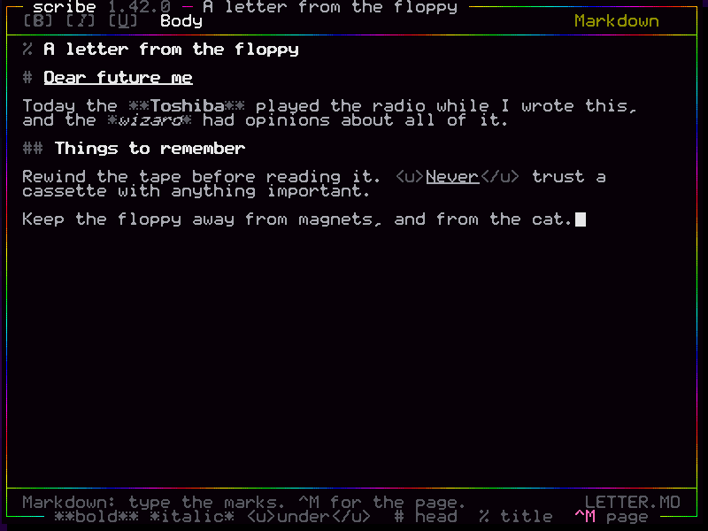

# scribe

A small word processor. `scribe` starts a new document; `scribe letter`
opens `LETTER.MD` from your inventory[^1], or starts it.

Every letter your keyboard types goes in, Cyrillic and Hebrew included.
Documents are saved as Markdown in UTF-8, readable on any computer.

## Styles

- **Ctrl-B, Ctrl-I, Ctrl-U:** Bold, italic, underline, on the selection or on what you type next.
- **Ctrl-P:** The paragraph's next style: Body, Title, Heading 1 to 4.
- **Ctrl-T, Ctrl-1 to Ctrl-4, Ctrl-0:** Title, Heading 1 to 4, Body.

Enter after a title or heading starts an ordinary paragraph.

## Moving and editing

- **Arrows; Ctrl with Left/Right or Up/Down:** By letter, word or paragraph.
- **Home / End; Ctrl-Home / Ctrl-End:** Line or document.
- **PgUp / PgDn:** A screen.
- **Shift with any of those:** Select. **Ctrl-A** selects everything.
- **Backspace / Delete; with Ctrl:** A character or the selection; a word.
- **Ctrl-C / Ctrl-X / Ctrl-V:** Copy, cut, paste (scribe's own clipboard, styles kept).
- **Ctrl-Z; Ctrl-Y or Ctrl-Shift-Z:** Undo, redo (sixteen steps).
- **Tab:** Four spaces.

## The Markdown view

**Ctrl-M** shows the document as the text it is saved as, marks dimmed,
and lets you edit it there; Ctrl-M again goes back. The style keys put
marks in or take them out.

- **`% `:** Title.
- **`# ` to `#### `:** Heading 1 to 4.
- **`**text**`, `*text*`, `<u>text</u>`:** Bold, italic, underline.
- **`\*`, `\<`, `\\`:** A real star, bracket or backslash.

Each line is one paragraph.

## Saving

- **Ctrl-S:** Save. A new document asks for a name (eight letters; `.MD` is added).
- **Ctrl-O:** Open, from the inventory.
- **Ctrl-N:** A new document.
- **Esc:** Leave; with unsaved changes it asks first, and Esc again leaves without saving.

A `*` after the name means unsaved changes. Documents hold up to 16 KB
each and go into the folder `scribe` was opened for: `scribe notes/plan`
keeps `PLAN.MD` in `NOTES`.

[^1]: [inventory](inventory.md)
