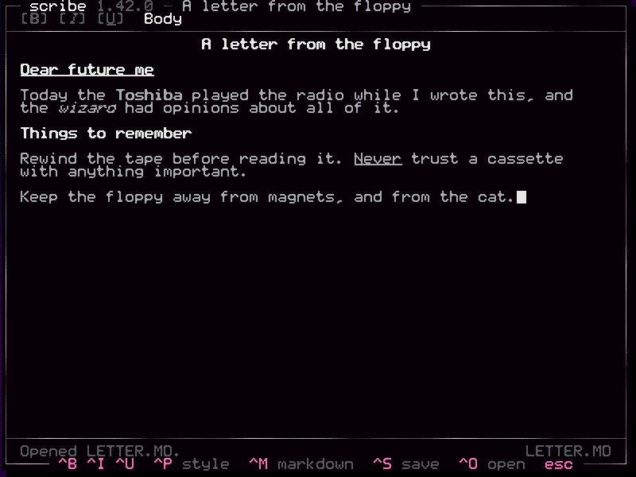

# scribe

A small word processor. Type `scribe` at the prompt for a new document, or
`scribe letter` to open `LETTER.MD` from your inventory[^1]
(or start it, if it isn't there).

    here> scribe letter

It takes the whole screen: the document's name along the top, a toolbar
showing **B**, *I* and U and the current paragraph's style, your text in
the middle, and a status line and the keys along the bottom.

Every letter your keyboard types goes in, whichever of the seventeen
keyboards is chosen: accents, Cyrillic, Hebrew (shown right to left) and
the rest. Documents are saved as UTF-8, so they read right on any other
computer.

## Formatting

**Character styles** apply to the selected text. With nothing selected,
they switch the style of what you type next. The toolbar lights up to show
what typing will look like.

| Key | Style |
|---|---|
| Ctrl-B | **Bold** |
| Ctrl-I | *Italic* |
| Ctrl-U | Underline |

**Paragraph styles** apply to the paragraph the cursor is in, or to every
paragraph the selection touches.

| Key | Style |
|---|---|
| Ctrl-P | The next style in turn: Body → Title → Heading 1 → 2 → 3 → 4 → Body |
| Ctrl-T | Title (centred) |
| Ctrl-1 … Ctrl-4 | Heading 1 to 4 |
| Ctrl-0 | Body text |

Pressing Enter at the end of a title or heading starts an ordinary
paragraph, because that is nearly always what you want next.

## Moving and selecting

| Key | What it does |
|---|---|
| Arrows | Move |
| Ctrl + Left / Right | A word at a time |
| Ctrl + Up / Down | A paragraph at a time |
| Home / End | Start or end of the line |
| Ctrl + Home / End | Start or end of the document |
| Page Up / Page Down | A screen at a time |
| Shift + any of those | Select |
| Ctrl-A | Select everything |
| Backspace / Delete | Remove a character, or the selection |
| Ctrl + Backspace / Delete | Remove a word |
| Ctrl-C / Ctrl-X / Ctrl-V | Copy, cut, paste |
| Ctrl-Z | Undo |
| Ctrl-Y, or Ctrl-Shift-Z | Redo |
| Tab | Four spaces |

Typing over a selection replaces it. The clipboard is scribe's own and
keeps the styling; it lasts until scribe closes. Undo goes back sixteen
steps; a run of typing, or of deleting, is one step.

## Markdown

Documents are saved as Markdown, a plain-text format that marks styles
with symbols:

    % A title
    # Heading 1
    ## Heading 2
    Ordinary text with **bold**, *italic* and <u>underlined</u> words.

In the normal view you never see these marks: bold just looks bold. If you
would rather write the marks yourself, press **Ctrl-M**.

The **Markdown view** shows the same document as the text it is saved as,
and you can edit it there. The marks are shown dim, and the words between
them already look the way they will: bold, slanted, underlined or a
heading. Press Ctrl-M again to go back to the page. The cursor stays on the
same word both ways.

In the Markdown view:

- Ctrl-B, Ctrl-I and Ctrl-U put the marks around the selection, or take
  them away if they are already there. With nothing selected, they put down
  an empty pair with the cursor inside.
- Ctrl-P, Ctrl-T and Ctrl-0 to 4 change the marks at the start of the line.
- Saving saves the text exactly as you typed it.

The marks FLOPOS understands:

- **`% ` at the start of a line**: Title.
- **`# `, `## `, `### `, `#### ` at the start of a line**: Heading 1 to 4.
- **`**text**`**: Bold
- **`*text*`**: Italic
- **`<u>text</u>`**: Underline (Markdown has none of its own; this is the HTML way, which most Markdown tools show).
- **`\*`, `\<`, `\\`**: A real star, angle bracket or backslash rather than a mark.

Each line is one paragraph.

From picocom, Ctrl-M arrives as Enter and Ctrl-I as Tab, so the Markdown
view and italic need the laptop's own keyboard.

## Saving and opening

- **Ctrl-S**: Save. A new document asks for a name first: up to eight letters, and it gets `.MD` if you give no ending.
- **Ctrl-O**: Open: goes to the inventory, where Enter on a document brings it back here.
- **Ctrl-N**: A new, empty document.
- **Esc**: Leave. If there are unsaved changes, it says so first; Esc again leaves without saving.

A `*` after the name at the top means there are unsaved changes.

## Where documents live

In the inventory[^1], under the names you give them, as many
as fit on the floppy. Each holds up to 16KB of text and takes only the
room it needs. A document goes into the folder `scribe` was opened for:
`scribe notes/plan` keeps `PLAN.MD` in the folder `NOTES`, and
<kbd>W</kbd> in the inventory starts one in the folder you are looking at.

They are ordinary text files. Put the floppy in any computer and open them
in a text editor or any Markdown viewer. Swedish letters are saved as
UTF-8, so they look right everywhere.

When you write a new version of FLOPOS to the floppy, `writefloppy.sh`
keeps your documents unless you ask for `--fresh`.

[^1]: [inventory](inventory.md)
